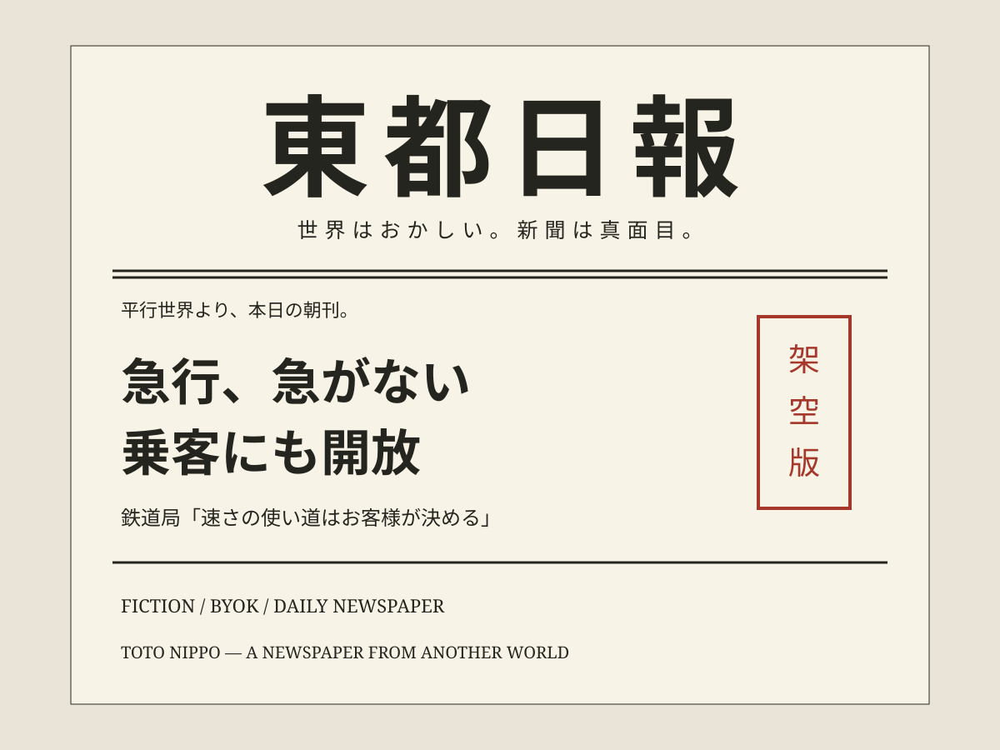

# 東都日報 — TOTO NIPPO v0.3.0

**世界はおかしい。新聞は真面目。**

平行世界の出来事を、真面目な新聞の文体で読む架空の朝刊です。

[アプリを開く](https://masato-lab.pages.dev/apps/toto-nippo/) · [MASATO LAB](https://masato-lab.pages.dev/tools/toto-nippo)



## 特徴

- 今日を中心に前後50年の日付を指定。
- アプリを開いた日の新聞を受け取る。保存済みの号はAPI呼び出しなしで再表示。
- 交通、食、学校、文化、スポーツなど20分野。各号で異なる5分野を選び、最近の題材の偏りを抑制。
- OpenAI APIキーを自分で入力するBYOK方式。API利用料金は各利用者の負担です。
- JPEGプレビュー・ダウンロード・対応端末の共有メニュー。画像の長押し保存も利用できます。
- HTMLで紙面を共有し、JSONで個別保存・全号バックアップ。取り込み時は同日でも別版を保持。

## データと生成

静的ファイルだけで動作します。共通の配信サーバー・会員登録はありません。キーは通常メモリに保持し、利用者が希望したときだけブラウザーに保存します。新聞の書き出しにキーは含めません。

Responses API / gpt-5.4-mini / structured outputs / store:false。ブラウザーからOpenAIへ直接送信します。当日自動生成はキー入力と設定が必要で、別日付を選んだだけでは有料生成しません。

新聞は端末・ブラウザー・サイトごとのIndexedDBに保存されます。別の人が同じ日付で生成しても同じ紙面にはなりません。同じ紙面を読むにはHTML/JSONで共有してください。保存済み記事との一致・類似チェックを行いますが、意味的な重複を完全には保証しません。再試行は最大2回の生成までです。

記事はすべてフィクションです。ブラウザーのデータ消去に備え、JSONバックアップをご利用ください。端末の共有先や保存方法はブラウザーによって異なります。

## ローカル実行

```sh
python3 -m http.server 8080 --directory dist
```

http://localhost:8080 を開きます。公開時は `dist/` を静的ホスティングへ配置してください。

## 検証

```sh
node --test tests/core.test.mjs
```

日付・記事検証・題材選択・重複判定・API通信のモックを検証。ブラウザーではサンプル表示、HTML入出力、保存済み紙面の再表示、JPEGプレビューとダウンロードを確認しています。実際の有料生成はAPIキー未提供のため未検証です。

## PWA

Android Chromeの「アプリをインストール」、iPhone Safariの共有→「ホーム画面に追加」に対応。初回オンライン読み込み後は保存済み新聞と見本をオフラインで閲覧できます。新規生成はオンライン限定です。更新はアプリの全ウィンドウを閉じて再起動すると反映されます。HTTPSまたはlocalhostで動作します。
